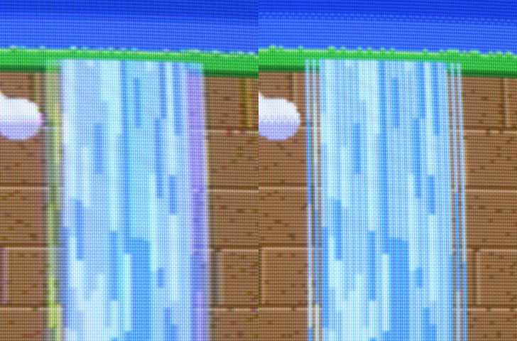

# Lola Retro

A CRT simulation that models the whole analog chain, not just scanlines:

**console video encoder → cable → TV decoder → electron beam → phosphor mask → glass**

Games from the CRT era were drawn for that chain. Dithered waterfalls turned translucent on composite,
1-pixel stripes became rainbow shimmer, PlayStation's 4×4 dither melted into smooth gradients.
On an LCD you only see the raw pixels. This project tries to bring the rest back.

Named after Lola, my retriever. Retro because it is retro.

[](https://www.youtube.com/watch?v=7losgxx2cp0)

*Video: [Lola Retro in action](https://www.youtube.com/watch?v=7losgxx2cp0)*



*Same frame, same tube. Left: composite, the 1-pixel waterfall stripes blend into translucent water with a rainbow edge. Right: RGB, the raw stripes.*

## Quick start

Copy `shaders/lola-retro` into RetroArch's shader folder, then in a game open **Quick Menu → Shaders → Load**
and pick `lola-retro/curved/consumer-tv-composite.slangp`. Default core settings are fine for most systems;
the few that matter are in [RECOMMENDED-CORES.md](shaders/lola-retro/RECOMMENDED-CORES.md).
Every preset also comes in a `flat/` version without curvature:


## What is in here

| Folder | Contents |
|---|---|
| `shaders/lola-retro/` | The RetroArch shader pack (slang): 8 presets, each in a `curved/` and a `flat/` version. Install instructions in its [README](shaders/lola-retro/README.md), cores and settings per system in [RECOMMENDED-CORES.md](shaders/lola-retro/RECOMMENDED-CORES.md). |
| `web/lola-retro.html` | The original WebGL version. Open it in a browser, try test scenes or drop in your own screenshots. |
| `tools/` | Preset generator, compile checker and a headless preview renderer. |
| `test-images/` | Native-resolution test frames used for the previews. |
| `docs/` | Preview images rendered by RetroArch. |

## Presets

| | |
|---|---|
|  **Consumer TV (Composite)** |  **Consumer TV (SCART RGB)** |
|  **Trinitron (S-Video)** |  **Old TV (RF)** |
|  **PC Monitor (VGA)** |  **Amiga 1084S** |

Also included: **Studio Monitor (RGB)** and **CRT Projector**.

## What is simulated

- **Composite and RF signal.** RGB is encoded to YUV and QAM-modulated onto the 3.58 MHz (NTSC) or 4.43 MHz (PAL)
  subcarrier, with each console's real pixel clock and subcarrier phase per line and per field.
  SNES (227⅓ cycles per line) crawls diagonally, Mega Drive (exactly 228) stands still, PlayStation (227½) flips every line.
- **The TV's decoder.** A luma trap or a 2-line comb filter, narrow consumer chroma bandwidth, PAL delay line,
  and the TV knobs (sharpness, colour, tint, brightness, contrast).
- **S-Video and RGB** skip the parts of that chain they skipped in real life.
- **Electron beam.** Each line is a Gaussian spot whose width grows with brightness, per colour gun.
  Bright lines merge, dark lines show gaps. Interlaced fields alternate; VGA 200-line modes are drawn twice.
- **Phosphor mask.** Aperture grille (with Trinitron damper wires), slot mask, shadow mask, or a projection screen.
- **Glass.** Curvature, halation, white point (6500–9300 K), vignette, room reflection, misconvergence, afterglow.

## Tools

```
python3 tools/make_presets.py     # regenerate the curved/ and flat/ .slangp files from one table
python3 tools/check_shaders.py    # compile every pass with glslangValidator
tools/render-preview.sh PRESET IMAGE OUT.png [glcore|vulkan]   # Linux: render a frame in headless RetroArch
```

## License

MIT, see [LICENSE](LICENSE).
