# Lola Retro

**A CRT shader for RetroArch that simulates the whole analog chain, not just scanlines.**

`console video encoder → cable → TV decoder → electron beam → phosphor mask → glass`

Games from the CRT era were drawn for that chain. Dithered waterfalls turned translucent on composite,
1-pixel stripes became rainbow shimmer, PlayStation's 4×4 dither melted into smooth gradients.
On an LCD you only see the raw pixels. Lola Retro brings the rest back.

Named after Lola, my retriever. Retro because it is retro.

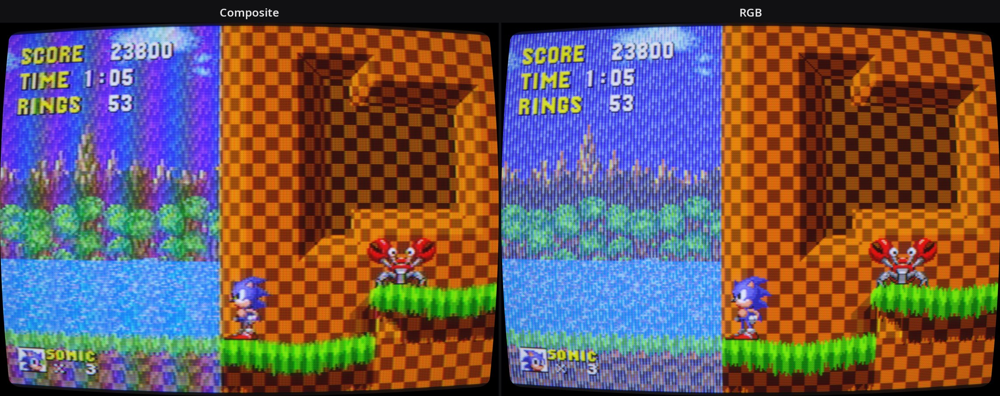

<sub>Same frame, same tube, different cable. On composite the striped background blends into soft colour with a
little rainbow, just as it did on a living-room TV. On RGB you see the stripes the artists actually drew.</sub>

## Videos

| | |
|---|---|
| [](https://www.youtube.com/watch?v=7losgxx2cp0) | **[Lola Retro in action](https://www.youtube.com/watch?v=7losgxx2cp0)**<br>An older version. The current one has a more realistic, more modest rainbow. |
| [](https://www.youtube.com/watch?v=xdj4simbOp4) | **[Super Turrican on SNES](https://www.youtube.com/watch?v=xdj4simbOp4)** |
| [](https://www.youtube.com/watch?v=Cz7tewURyZg) | **[Earthworm Jim on SNES](https://www.youtube.com/watch?v=Cz7tewURyZg)** |

## Quick start

1. Copy `shaders/lola-retro` into RetroArch's shader folder (**Settings → Directory → Video Shaders** shows where it is).
2. Start a game, open **Quick Menu → Shaders → Load** and pick `lola-retro/curved/consumer-tv-composite.slangp`.
3. Video driver must be Vulkan, glcore, D3D11, D3D12 or Metal (the old `gl` driver does not run slang shaders).
4. HDR display? Use the same presets from `lola-retro/hdr/curved`; setup is in [HDR](shaders/lola-retro/README.md#hdr).

Default core settings are fine for most systems. The few that matter are in
[RECOMMENDED-CORES.md](shaders/lola-retro/RECOMMENDED-CORES.md).

Every preset also comes in a `flat/` version without curvature:

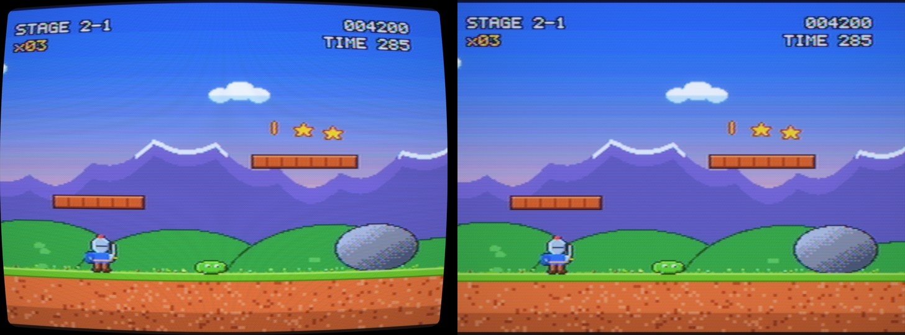

## Raw pixels, composite, RGB

Full-resolution RetroArch screenshots. The bottom row is a 1:1 crop of each.

**Sonic the Hedgehog (Mega Drive).** The background is drawn with 1-pixel vertical stripes. The Mega Drive's
pixel clock puts those stripes right next to the colour subcarrier, so composite turns them into blended colour
and a rainbow shimmer. RGB keeps the stripes.

How strong that rainbow was depended on the console and the TV. Early Model 1 Mega Drives had a cheap encoder
with weak filters and showed it strongly; later models and TVs with a comb filter showed much less. The default is
a typical console. Set **Luma trap in the console** to 0 for an early Model 1, or to 1 for a later model.

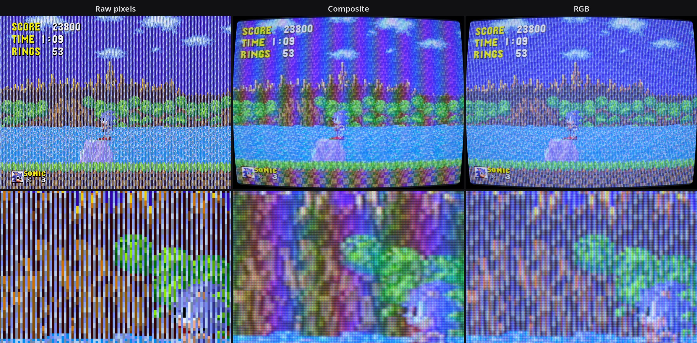

**Super Mario Bros. (NES).** Composite softens colour and lets it bleed past the edges, and the dithered side
of the pipe melts into a smooth shade. RGB stays sharp, only rounded by the beam.

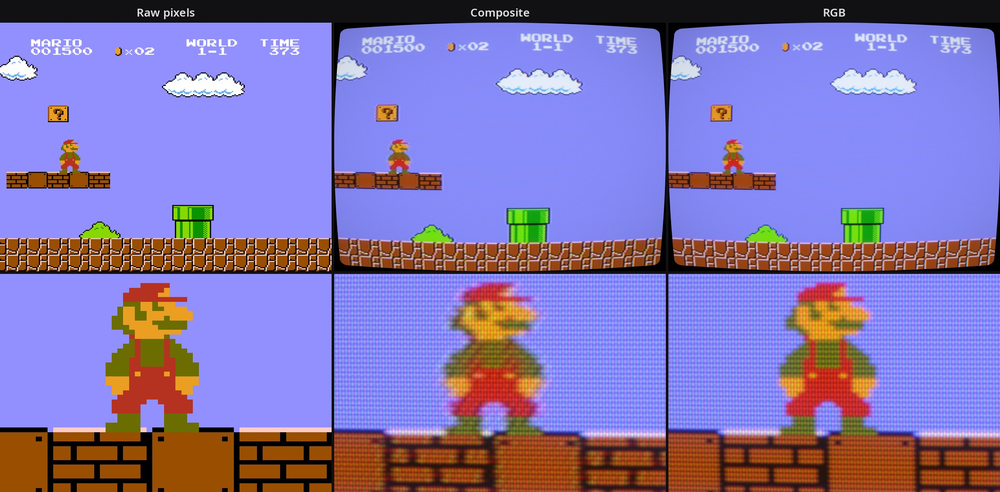

## Presets

| | |
|---|---|
| 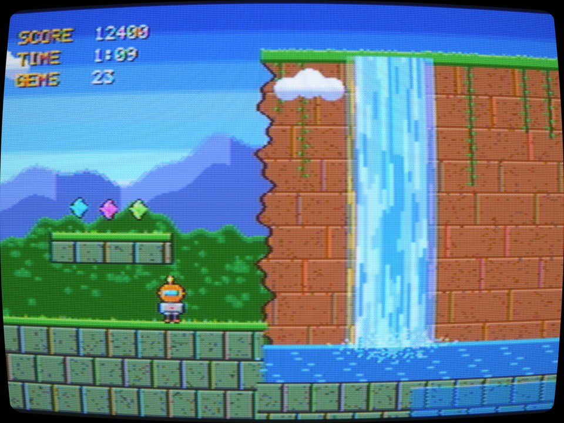 **Consumer TV (Composite)**<br>Start here. The TV most people had. | 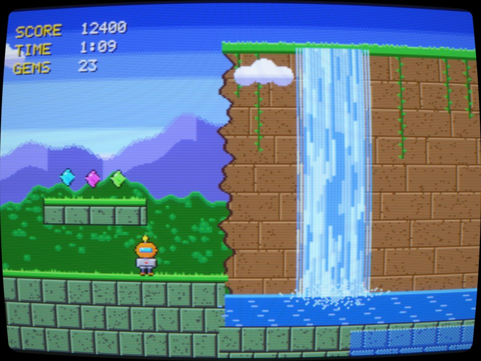 **Consumer TV (SCART RGB)**<br>Same TV, clean picture. |
| 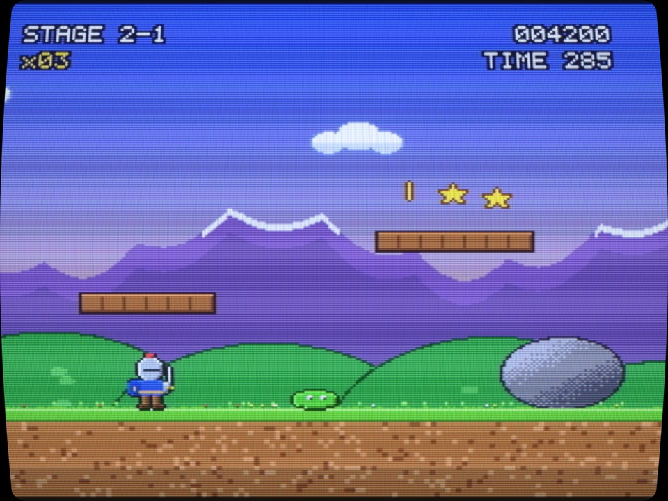 **Trinitron (S-Video)**<br>PS2, GameCube, N64. | 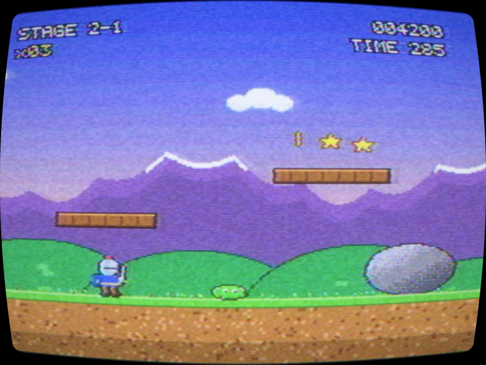 **Old TV (RF)**<br>Antenna cable, snow and ghosting. |
| 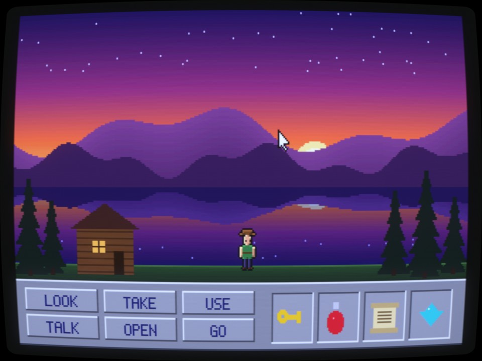 **PC Monitor (VGA)**<br>DOS games, Dreamcast VGA. | 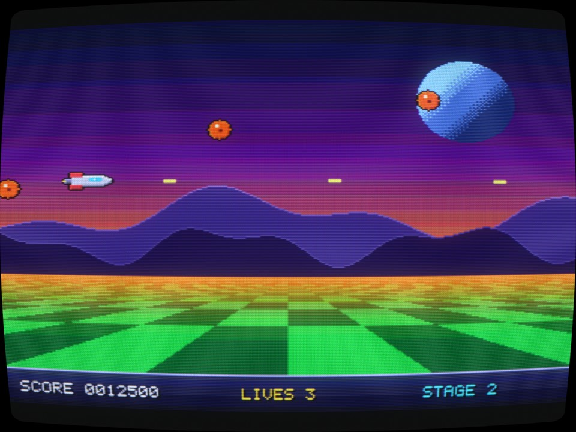 **Amiga 1084S**<br>Amiga and 15 kHz arcade. |

Also included: **Studio Monitor (RGB)** for the PVM look and **CRT Projector** for 24 kHz arcade games.
Which preset and settings to use per system: [RECOMMENDED-CORES.md](shaders/lola-retro/RECOMMENDED-CORES.md).

## What is simulated

- **Composite and RF signal.** RGB is encoded to YUV and QAM-modulated onto the 3.58 MHz (NTSC) or 4.43 MHz (PAL)
  subcarrier, with each console's real pixel clock and subcarrier phase per line and per field.
  SNES (227⅓ cycles per line) crawls diagonally, Mega Drive (exactly 228) stands still, PlayStation (227½) flips every line.
- **The TV's decoder.** A luma trap or a 2-line comb filter, narrow consumer chroma bandwidth, PAL delay line,
  automatic gain and colour control, and the TV knobs (sharpness, colour, tint, brightness, contrast).
- **S-Video and RGB** skip the parts of that chain they skipped in real life.
- **Electron beam.** Each line is a spot whose width grows with brightness, in both directions and per colour gun.
  Bright detail merges and rounds off, dark detail stays sharp. Interlaced fields alternate; VGA 200-line modes are drawn twice.
- **Phosphor mask.** Aperture grille (with Trinitron damper wires), slot mask, shadow mask, or a projection screen.
- **Glass.** Curvature, halation, white point (6500–9300 K), vignette, room reflection, misconvergence, afterglow.
- **Internal resolution.** PS1 and PS2 cores running at 2× and up are read as blocks of one console pixel,
  so the signal stays right and the extra detail only makes edges smoother.
- **HDR output.** On an HDR display the phosphor dots and scanline centres get the brightness a real tube
  had, instead of being squeezed under the SDR white level. The `hdr` presets write HDR10 themselves.

## Tested against test patterns

The chain is checked with measured patterns, not only by eye.

**NTSC test patterns** ([patterns.wrwetzel.com](https://patterns.wrwetzel.com)). On composite the fine vertical
stripes and checkerboards turn into rainbow, and the resolution wedge shows colour where the lines get close to the
subcarrier. RGB shows none of that. Colour bars come out the same on every cable.

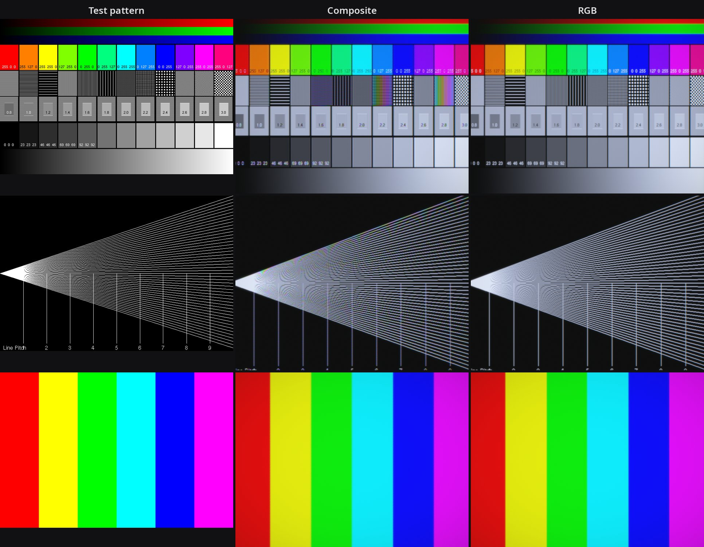

**[240p Test Suite](https://junkerhq.net/240p/) on the Mega Drive.** Colour Bleed (1-pixel stripes) and
Checkerboard, the two patterns that show what composite does to a Mega Drive. On composite the white stripes become
a full rainbow and the coloured ones beat against the subcarrier. On SNES the same test gives a much weaker rainbow,
because its pixel clock puts the stripes further from the subcarrier. Nothing in the shader is tuned for this;
it follows from each console's real timing.

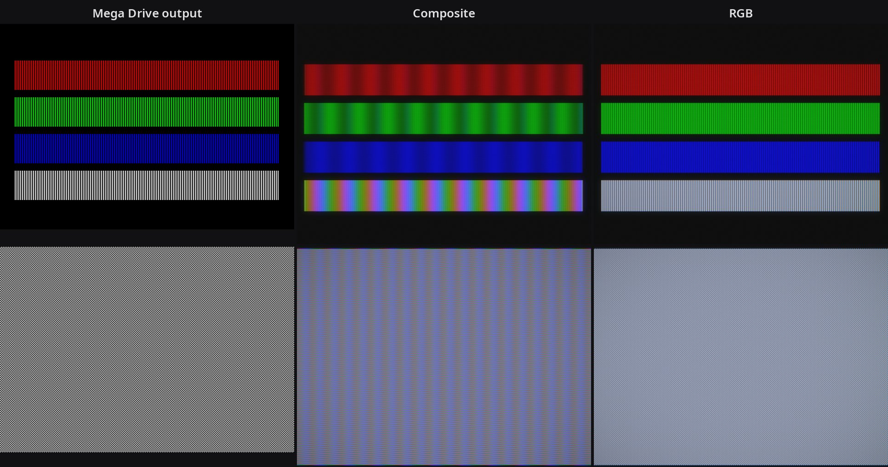

Measured on synthetic patterns:

| Test | Result |
|---|---|
| 75% colour bars, every cable, NTSC and PAL | within about 2/255 of the source |
| Alternating lines (light output) | 0.4996 of white, 0.5 expected: the beam conserves energy |
| Composite at the subcarrier (3.58 MHz) | luma notched out, the energy shows up as colour (the rainbow) |
| Comb filter and S-Video | no false colour |
| RGB bandwidth | about 6.5 MHz, like a consumer TV's video amplifier |

## What is in here

| Folder | Contents |
|---|---|
| `shaders/lola-retro/` | The RetroArch shader pack (slang): 8 presets, each in a `curved/` and a `flat/` version, plus the same for HDR displays in `hdr/`. Details in its [README](shaders/lola-retro/README.md). |
| `web/lola-retro.html` | The original WebGL version. Open it in a browser, try test scenes or drop in your own screenshots. |
| `tools/` | Preset generator, compile checker and a headless preview renderer. |
| `test-images/` | Native-resolution test frames used for the previews. |
| `docs/` | Screenshots used in this README. |

## Tools

```
python3 tools/make_presets.py     # regenerate the curved/ and flat/ .slangp files from one table
python3 tools/check_shaders.py    # compile every pass with glslangValidator
tools/render-preview.sh PRESET IMAGE OUT.png [glcore|vulkan]   # Linux: render a frame in headless RetroArch
```

## License

MIT, see [LICENSE](LICENSE). Game screenshots are shown only to demonstrate the shader; the games belong to their owners.
